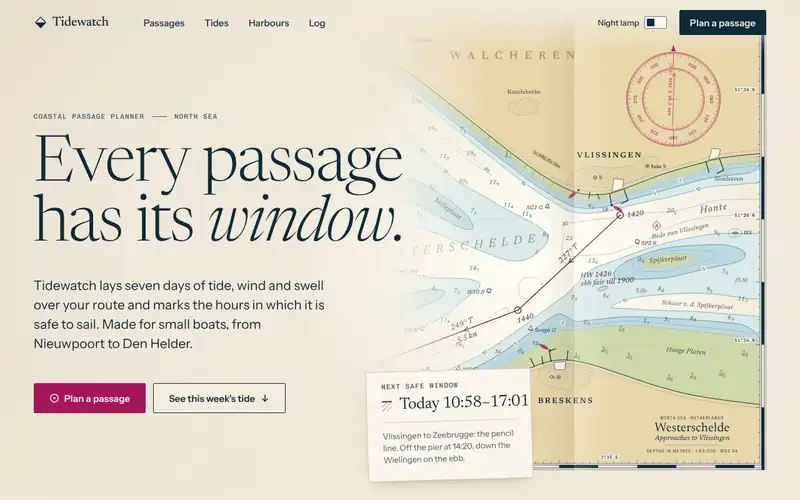
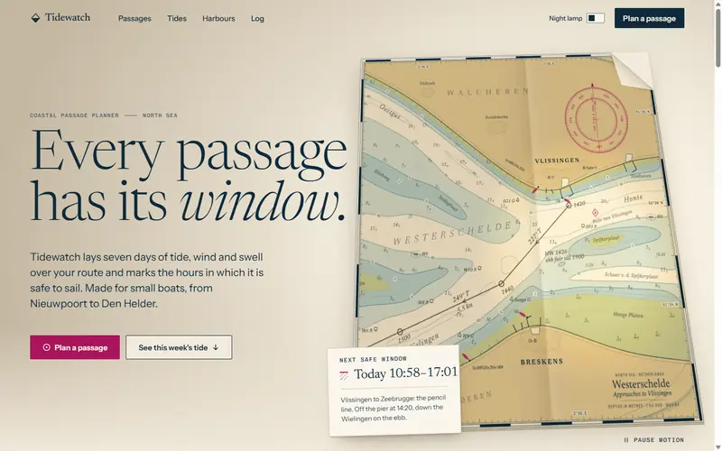
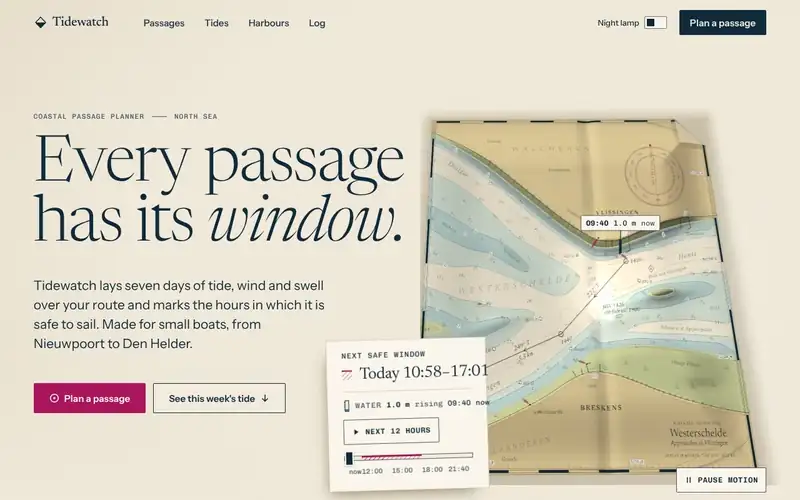
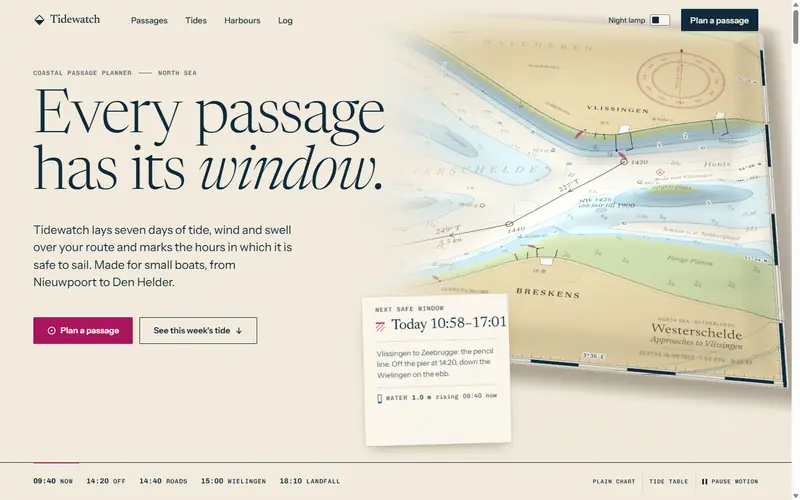
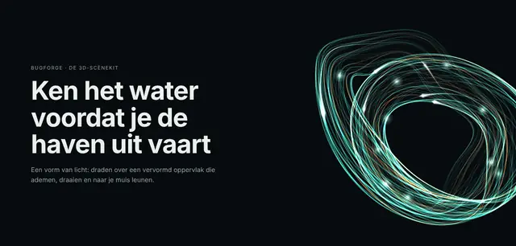
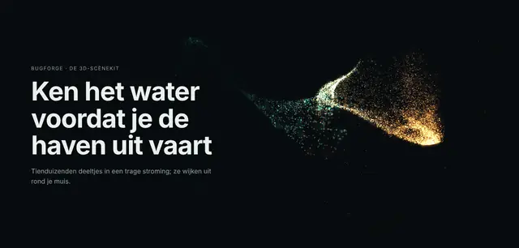
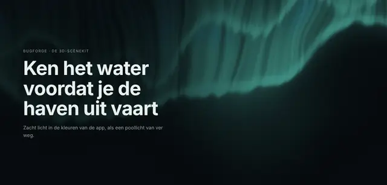
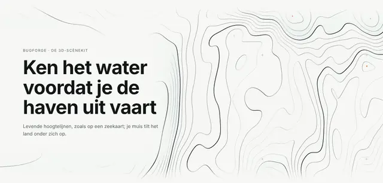

# BugForge

Claude skills that build working web apps for you, and that read, audit and improve the apps you
already have. Safe by default, clean-room, and written for people to read.

BugForge is a fork of [replica-skill](https://github.com/Jakeschincariol/replica-skill) by Jake
Schincariol (MIT). It keeps the idea (map an app, rebuild it, test it, make it your own) and
changes the rest:

- **It builds.** From a URL, an idea or your repo to a running, tested app, not a to-do list.
- **It reads apps that exist.** Your codebase, your live site, and competitors side by side. Fixes
  go on a separate branch, one small commit per finding, with a test where one can be written.
- **You pick the level.** How far it goes, from 1 (Subtle) to 5 (Cinematic), for the look, the
  dashboards, the tests and the security check. Say "niveau 4" or "showpiece"; with no level it
  asks you once.
- **A look from the app's own world.** Three moving concepts drawn from what your app is about,
  you pick one, and that look is built into your app; what is yours and good (a logo, a colour, a
  font, a voice) stays. From level 4 a living 3D scene made for the app follows the pointer; at
  level 5 the page becomes a 3D journey as you scroll.
- **You see the result on your own screen.** Every change shows on your localhost, with before
  and after screenshots, a pixel count that proves it changed, and a short film. For the look, the
  gate checks that proof.
- **Your stack.** Four stack profiles, and any web profile can be a PWA.
- **Containers, not hosting.** You get a Dockerfile, a compose file and a RUN.md. BugForge never deploys.
- **Stripe with iDEAL**, in test mode only.
- **Safety is a gate.** Scripts check secrets, risky code, dependencies, headers, trackers and the
  container setup, and the work stops until they pass.
- **Tested like a user would.** A browser walks every page at phone, tablet and desktop width, in
  light and dark: console errors, broken links, accessibility, speed against a budget, edge cases.
- **You decide.** A checkpoint after every phase, or auto mode: say "run it all" and it goes from
  phase to phase on its own and fixes what fails. The security go is always yours.

BugForge has 8 skills. `/forge` runs a whole project; the other seven each do one kind of work.
Four of them have parts you can call on their own, such as `/forge-design motion` or
`/forge-check secure`. The skills' scripts are standard-library Python 3.9+, each with its tests.

## Quick start

1. Install BugForge (below).
2. Open Claude Code in a new, empty folder (a new app) or in your repo (an existing app).
3. Type `/forge` (installed as a plugin: `/bugforge:forge`) and say what you want:
   - `/forge rebuild https://example.com as my own app` (clone mode)
   - `/forge a booking app for my hair salon` (idea mode)
   - `/forge improve this app` (improve mode)

Or ask one skill for one thing, with a level if you like:

- `/forge-design maak mijn app mooier, niveau 4`: three concepts to pick from, then the new look,
  motion and a 3D hero built into your app.
- `/forge-design motion level 3`: scroll storytelling and real depth, no library.
- `/forge-check test grondig`: the tests at level 4 (Thorough).
- `/forge-check secure`: the security gate; it asks how deep.

Claude asks a few questions, runs the first phase, shows you a checkpoint of at most 5 lines plus
the gate's result, and waits. Say "go" to continue, or ask for changes first. Say "run it all on
your own" for auto mode (below). Say "where were we" in a new session to pick up where you left off.

## Levels

Each level includes the ones below it. A level is a promise both ways: never less than it asks,
never more.

| level | look: design, motion and 3D |
| --- | --- |
| 1 Subtle (Subtiel) | Clean and calm. Every button, link and field reacts when you point at it or press it. |
| 2 Polished (Verzorgd) | + content glides in, pages change smoothly, numbers count up, messages slide in and out. |
| 3 Expressive (Expressief) | + scrolling tells a story, cards tilt with real depth, charts draw themselves, one moment only this app has. |
| 4 Showpiece | + a living 3D scene made for this app that follows your pointer, and 3D cards, objects and charts. |
| 5 Cinematic (Cinematisch) | + a 3D journey as you scroll, like a film; the forms react to you and to the app's live data. |

The other three scales:

| level | dashboard | test | secure |
| --- | --- | --- | --- |
| 1 | Subtle (Subtiel): 3 to 5 key numbers, one chart, one table | Quick (Snel): the app starts, the main flow works once | Quick (Snel): leaked secrets and risky code |
| 2 | Polished (Verzorgd): tiles with trends, a period filter, every state | Basic (Basis): every user flow, unit tests for the logic | Basic (Basis): known holes in packages, headers, trackers |
| 3 | Expressive (Expressief): charts that draw in, drill down, compare periods | Standard (Standaard): odd input, every page at 3 widths, no data leaks | Standard (Standaard): input traced to risky code, OWASP, AVG/GDPR |
| 4 | Showpiece: a control-room screen, linked panels, charts with depth | Thorough (Grondig): every form, speed limits, offline, keyboard only | Thorough (Grondig): your running app probed, two users tried on each other's data |
| 5 | Cinematic (Cinematisch): your data as a 3D landscape | Exhaustive (Uitputtend): every state, hostile input, slow networks | Exhaustive (Uitputtend): a threat model, every route against every role |

- Say it in any words, English or Dutch: "niveau 4", "showpiece", "level 2", "grondig", "snel".
  With no level, the skill asks one question with the table above, also in auto mode. `/forge`
  asks once at the start, only for the parts that have no level yet.
- A look level shows on the first screen at rest (no scroll, no click), in the default theme, at
  1440 and 390 wide, and it keeps all of the level below. There you see at least: one consistent
  design in the app's own taste, its controls with a focus ring, hover and press you notice (1);
  the screen arriving in steps, its numbers counting up (2); real depth: cards that lean in the
  still and 6 degrees or more toward the pointer, layers that stand apart (3); the living 3D scene
  made for the app, at least a third of the screen high at 1440 and full width at 390 (4); the
  journey's first chapter with the app's live data, the camera moving on the first scroll (5). The
  look review checks this on the after shots, with a separate judge when the session can start one.
- `forge/level.py` records your choice with your own words in `forge-work/levels.json`. The report
  of the work carries a `Level: N (Name)` line. The gate checks that line and the files the level
  asks for, and for the look and dashboards the work itself: the motion in your app's own code,
  frames that move, the dashboard items built (see "The gate" below; in improve mode too).
- Inside a forge project, secure never runs below 3 and test never below 2: test level 1 and
  secure levels 1 and 2 are for a check on its own.
- At level 4 and 5 the look installs Three.js (MIT) with your app's own package manager (npm,
  pnpm, yarn or bun), never from a CDN, and loads it only on the screens that use it, after the
  page is idle. Weak devices, no WebGL and reduced motion get a still picture of the scene. Levels
  1 to 3 add no library.

[`forge/levels.md`](plugin/forge/levels.md) has every level in full, and what each one must show.

## See it: the gallery

The [`examples/`](examples/) folder holds one made-up app at every look level, and the 3D scene kit
on its own page. They are plain files; the 3D ones need a small local server, because a browser
refuses module scripts from a double-clicked file. From the root of this repo:

```bash
python3 examples/serve.py
```

It serves the folder on http://127.0.0.1:8765 (your machine only) and opens the gallery's start page,
[`examples/index.html`](examples/index.html): the five levels side by side, the scene kit, and how to
open it all.

**Tidewatch**, a passage planner for small boats, at the five levels. The page is a paper sea chart
under a lamp; at night the lamp turns red, as it does on a boat. The words, the colours and the
type stay the same at every level; what changes is how much it moves and how deep it goes. Each
level keeps everything of the level below it.

| | |
| --- | --- |
|  |  |
| **1 Subtle** ([open](examples/levels/1/index.html)): the clean design; every control reacts to hover, focus and press | **2 Polished** ([open](examples/levels/2/index.html)): content arrives, the day's figures count up, the tide curve draws itself, the dialog glides |
|  |  |
| **3 Expressive** ([open](examples/levels/3/index.html)): the chart lies on the table as a sheet in 3D; a lamp swings over it on its own and follows your hand; the tide week stays pinned while its days go by | **4 Showpiece** ([open](examples/levels/4/index.html)): the printed chart becomes a live 3D relief of its own sea bed; the water rises and falls with the tide under a raking lamp |
|  | |
| **5 Cinematic** ([open](examples/levels/5/index.html)): "Sail the pencil line", a 3D journey along the course as you scroll, with its own shaders and the wind as streaks | |

These clips were recorded on a machine without a graphics card, where WebGL runs in software; on your
own computer levels 4 and 5 run smoothly.

[`examples/levels/README.md`](examples/levels/README.md) explains the concept, the type, the
colours and what each level adds.

**The 3D scene kit** on its own page, [`examples/scenes/`](examples/scenes/index.html): every scene
of the kit, with its colours taken from the page, in light and dark, following the pointer. These
clips were recorded from that page:

| | |
| --- | --- |
|  |  |
| `form.js`: an object made of strands of light | `field.js`: points adrift in a current |
|  |  |
| `aurora.js`, mode water: shallow water with caustics | `aurora.js`, mode aurora: curtains of light |
|  |  |
| `contour.js`: living contour lines | `datascape.js`: the app's numbers as a sculpture |

## How /forge works

### Three modes

| mode | you give | phases, in order |
| --- | --- | --- |
| clone | the URL of an app to rebuild | recon, compare\*, plan, design, build, dashboard\*, motion\*, test, diff, brand, launch, secure, pack |
| idea | an idea in your own words | compare\*, plan, design, build, dashboard\*, motion\*, test, brand, launch, secure, pack |
| improve | your own repo | audit, inspect\*, improve, test, secure |

\* optional: skipped only when you say so, and your reason is recorded. secure is never skipped.
motion is skipped only at look level 1: from level 2 the motion phase builds what the level adds,
so to leave it out you first record look level 1, and the app then stays near level 1.

In improve mode, `/forge-improve` offers the look next to the findings, for you to pick: a redesign
(three concepts first), motion and 3D, and a dashboard when you name one or the app has a data
screen, each at a level. `/forge-research compare` (competitors) and `/forge-build pack`
(containers) are there when you ask for them.

Each phase is a skill or a part of one: plan is `/forge-plan`, recon is `/forge-research recon`,
pack is `/forge-build pack`. You can also call any skill on its own: "redesign my app", "add a
dashboard", "add animations", "test my app" or "is this safe" each start the skill that does it,
on your own repo too.

### The gate

`forge/gate.py` keeps the record in `forge-work/state.json` in your project. Per phase:

1. `gate.py status` names the next phase.
2. Claude runs that phase's skill.
3. `gate.py check <phase>` runs the phase's exit checks (`forge/phasecheck.py`, with the list in
   `forge/phasecheck.json`), in your project's mode: what the phase's skill promises is there.
   - Its files, with no placeholder of their template left (code blocks too) and text of its own
     in each section that must not stay empty: for design also the concept board with its three
     previews and a block per component with its states, for build the look review's rounds.
   - Its scripts pass: contrast, bugs, the walk, parity, brand sweep, codecheck, secret scan,
     packcheck, composecheck, the dashboard's numbers and the items of its level built in the app,
     the motion in the app's own code, the level checks (the report's `Level:` line and the files
     the level asks for), and in clone mode the copy check once forge-research recon kept the
     original's text.
   - The change shows: `changed.py` says VISIBLE CHANGE between the before and after shots of
     build, dashboard, motion, brand and launch, and from look level 2 a screen's entrance frames
     move, from look level 4 (dashboard level 5) a scene's frames too (`lookcheck.py moved`).
   - In improve mode the same for each part of the look the run picked: its report and its level,
     VISIBLE CHANGE on its before and after shots (`lookcheck.py looked`), and that part's scripts
     and frames. A finding needs no shots at the gate.
   - The reports of test, diff, secure, audit, inspect and improve, the level's evidence, and the
     shots and frames `lookcheck.py` reads are newer than the go before them (diff's report also
     newer than bugs.md and features.csv, which its fix loop changes).
4. Claude shows you the skill's checkpoint plus one line with the gate's result, and stops.
5. Only after your go: `gate.py done <phase> --approved '<your exact words>'`. It refuses when a
   check fails, the words are missing, or an earlier phase is still open.

Claude runs these for you, from your project root. To look yourself, set `FORGE` to the folder that
holds `forge/` and the `forge-*` folders: `~/.claude/skills` if you copied them there, `plugin/` in a
clone of this repo, or, with the plugin, the `installPath` of `bugforge@bugforge` that `claude plugin list --json` prints (a new one
after each update).

```bash
FORGE=~/.claude/skills   # copied in; with the plugin: its installPath (see above)
python3 $FORGE/forge/gate.py init --mode idea --about 'a booking app for my salon'   # clone, idea or improve
python3 $FORGE/forge/gate.py status          # every phase and the next step (--json)
python3 $FORGE/forge/gate.py check plan      # the exit checks of one phase (--json)
python3 $FORGE/forge/gate.py done plan --approved 'ja, ga door'
python3 $FORGE/forge/gate.py done plan --auto 'run it all on your own'        # auto mode; refused for secure
python3 $FORGE/forge/gate.py skip compare --reason 'no rivals worth reading'   # the phases with a * only
python3 $FORGE/forge/level.py show look --nl  # the levels, in Dutch
```

### Auto mode

Say it in your own words ("run it all", "do not stop after each phase", "doe alles zelf") and
BugForge goes from phase to phase without waiting. The gate still runs every exit check, and
records each phase with the words you asked for auto mode with; you get each checkpoint as a
report. It still stops for:

- the go of the secure phase, always, and any `Verdict: FAIL`;
- the level, when you named none, and your pick of the three concepts: taste is yours;
- a risk to accept, a bug to leave unfixed, a secret to rotate;
- the question whether a domain is yours, before any active test on it;
- a choice only you can make and that is costly to undo: the app's name, the stack profile when
  two fit, prices;
- a failure it could not fix in three tries, or a fix that turns out bigger than it looked.

The optional phases run, unless you said at the start which to leave out. Choices that are cheap
to change it makes itself and writes down with why; a fact only you can give (a business detail,
a domain, a key) becomes a `TO-FILL` line under "For you". In every mode a failed test, check or
scan is fixed at its cause, never by loosening the check. Auto mode does not carry over to a new
chat: it asks you again. Say "stop after each phase again" to turn auto mode off.

`init --force` starts over: it forgets every approval, and test, diff, secure, audit, inspect and
improve run again, since their reports must be newer than the new start.

## Stack profiles

| profile | stack | services in docker compose | health URL |
| --- | --- | --- | --- |
| laravel | PHP + MariaDB (Laravel) | nginx, PHP-FPM, MariaDB, queue worker | `/up` |
| django | Python + PostgreSQL or MariaDB (Django) | gunicorn with WhiteNoise, PostgreSQL | `/healthz` |
| next | Node/TypeScript + PostgreSQL (Next.js, self-hosted) | Node standalone server, PostgreSQL | `/api/health` |
| static | static site or SPA (Vite + nginx) | nginx with the built files | `/` |

- **PWA** is a switch, not a profile: `PWA: yes` in `forge-work/plan.md` adds a manifest, icons, a
  service worker, an offline page and safe caching rules (never a signed-in page or a POST).
- `forge-plan/profiles.md` is the one reference: how to pick, versions (with the date they were
  checked), auth, migrations, tests, Stripe library and the classic mistakes per profile.
- An existing codebase keeps its stack: `forge-check/detect.py` names the closest profile.
- Every server profile gets mailpit for development email (`COMPOSE_PROFILES=dev`).

## What you get at the end

Clone and idea mode, in your project root: the app, its tests, and `Dockerfile`,
`docker-compose.yml`, `.env.example`, `.dockerignore`, `RUN.md` (and `nginx.conf` for laravel and
static). RUN.md explains the first start, backups and restore, updates, logs and HTTPS behind your
own reverse proxy. You run it wherever you want.

Improve mode: the fixes you picked on a `forge/improve-<date>` branch, one commit per finding (with
a test where one can be written), and `forge-work/improve.md` with what was fixed, what was skipped
and why, and how to check each fix by hand. A new look you pick goes on that same branch, in the
folder your dev server runs from, so your own localhost shows it. A redesign with `/forge-design`
on its own goes on a `forge/redesign-<date>` branch instead. Nothing is merged or pushed: that is
your step.

Plans, reports and screenshots live in `forge-work/` in your project. It never ships: BugForge keeps
it out of git and out of every image. The reports you will read most:

| file in `forge-work/` | from | what it holds |
| --- | --- | --- |
| `design/concepts/` | `/forge-design` | the board with the three moving concepts you picked from |
| `design/brief.md`, `design/review.md`, `design/shots/` | `/forge-design` | the concept and signature of the look; the scores per screen and round; before and after shots, frames and the film |
| `design/redesign.md`, `design/specimen/` | `/forge-design` on your own app | how your app runs, each old value and its token, each commit and the proof; one page of the design system, shot before the build |
| `dashboard.md` (and `dashboard-<screen>.md`), `motion.md` | `/forge-design dashboard`, `/forge-design motion` | each number with its source, and where the app builds each item of the level; which moments move, at which level, and the proof they show |
| `levels.json` | every skill with a level | the levels you chose, in your own words |
| `test-plan.md`, `bugs.md`, `test/` | `/forge-check test` | every case and its result; the bugs; the walk's findings and the screenshots per round |
| `security.md`, `sbom.json` | `/forge-check secure` | the verdict, the findings and the OWASP coverage table; the list of every locked package |

## The skills

The eight skills are the folders in [`plugin/`](plugin), which is all the plugin holds. The
gallery (`examples/`), the tests and CI stay outside it, so an install holds only what the skills run.

| skill | parts | what it does |
| --- | --- | --- |
| `/forge` | | Runs a whole project, phase by phase, with the gate and your go after each phase, or straight through in auto mode. |
| `/forge-research` | recon, compare | Maps an app from public pages and your own account (screens, flows, components, data model, feature list); puts 2 to 5 competitors side by side and ranks what their users complain about and miss. |
| `/forge-plan` | | Picks the stack profile and PWA with you, records the look and dashboard levels; writes the schema, routes, payments and build order. |
| `/forge-design` | design, brand, dashboard, motion | Three moving concepts from the app's own world, then the brief, tokens, the theme and how you switch it, open fonts and icons, WCAG AA contrast, and the look built into your app (in an app that exists: the theme, the fonts, each component, then screen by screen, one commit each); your own name, palette and voice; dashboards on the app's own data; motion and 3D at your level, with the scene kit. Shows the result on your localhost with proof. |
| `/forge-build` | build, pack | Scaffolds with the official installer, then builds screen by screen: auth, data access, Stripe with iDEAL, email, jobs; shows the first slice and the finished app on your localhost; fits the container templates and runs the stack until it is healthy. In clone mode it checks that no text is copied from the original. |
| `/forge-check` | test, diff, secure, audit, inspect | Tests at your level (unit, Playwright, a walk of every page at three widths in light and dark, edge cases, a fix loop); scores a clone against the original; the security gate with a verdict PASS or FAIL; reads your codebase without changing it; looks at a live URL like a visitor. |
| `/forge-improve` | | One list of what to improve, from the audits and from the look (a redesign, motion and 3D, dashboards, each at a level), and the tests at a level; fixed on a new branch, one small commit each, tested where possible, then the security check. |
| `/forge-launch` | | Landing page in your concept at your look level, prices in EUR with VAT, privacy policy, terms, cookie check, basic SEO, launch checklist. |

## The 3D scene kit

`forge-design/scenes/` holds the scenes the look uses from level 4. Each is a starting point that
the concept changes until it could only belong to your app; when no scene of the kit draws the
concept's thing, your app gets a scene of its own on `stage.js`. A scene draws only what the app
knows, puts life into what the screen already shows instead of covering it, and gets its own
composition on a phone. It is mounted on its own stage, with a poster per theme and shape (wide and
phone), taken from the page itself, for weak devices, no WebGL and reduced motion.
[`forge-design/scenes.md`](plugin/forge-design/scenes.md) says which scene fits which app, which files to
copy and how to mount one in each stack.

| file | what it is |
| --- | --- |
| `stage.js` | the runtime under every WebGL scene: renderer, camera, colours from the tokens, pointer, pausing, reduced motion, quality, fallback, clean-up; the comment at its top is a whole scene, the start of an app's own |
| `lazy.js` | `lazyScene()` loads three and a scene only near the viewport and when the page is idle (never without WebGL), with the poster until then; `motionToggle()` is one pause button for every scene |
| `glsl.js` | shader pieces (noise, curl, fbm, palette, grain, fog, lines) for the kit's scenes, the app's own scene and its own shader |
| `aurora.js` | a shader atmosphere behind a hero or a whole page: modes `aurora`, `water` (clear, shallow water seen from above) and `mist` |
| `contour.js` | living contour lines, a map or a depth chart: flat or tilted in 3D (`view: "tilt"`), of invented land or of the app's own place from its `outline` (one lake, one trail, one plot), with places for the page's labels and a `phone` option |
| `field.js` | tens of thousands of GPU particles in a slow current: round points, or streaks that turn with their path (`streak`: wind, rain, traffic, a school of fish), and a `phone` option |
| `form.js` | a sculptural form of glowing strands (a ring, a knot, a coil) that breathes, turns and leans to the pointer |
| `datascape.js` | the app's own numbers as 3D bars or ridgelines, with hover (look level 5, dashboard level 5) |
| `depth.js`, `depth.css` | real depth with CSS 3D, no WebGL, no library: tilting cards, stacked panels, folds, a layered hero (from level 3) |
| `journey.js` | the level-5 director: a scroll trip with a camera through chapters, of `form.js`, `field.js`, `datascape.js` or the app's own scene |

## The scripts

Standard-library Python 3.9+, one job each. Every one has `--help`. Unless noted: exit 0 when
clean, 1 when something is at or above `--fail-on` (default `high`), 2 when it could not run (bad
input, or an incomplete scan). Exit 2 is never a pass. `--json` gives machine-readable output.

**forge/**

| usage | what it does |
| --- | --- |
| `gate.py {init,status,check,done,skip} ...` | the gate (above); 1 = refused |
| `phasecheck.py PHASE [--since TIME] [--until TIME] [--mode MODE] [--json]` | the exit checks of one phase, from `phasecheck.json`; gate.py runs it |
| `level.py {show,set,get,check} ...` | the levels: shows the table, records your choice with your words (`set look 4 --said 'niveau 4'`), checks a report and its evidence against it (`check look --report FILE --since TIME`; the gate gives its last go); 1 = no level yet, or the work is below it |
| `doccheck.py FILE [--template T] [--section S] [--no-sections] [--cases BUGS] [--specs P] [--rows A,B] [--names L] [--moved S] [--json]` | is a report filled in: no placeholder of its template left, text of its own in each section, the test cases, a file a line names, no item left in a section that must end empty; phasecheck runs it |
| `workcheck.py {features,built,tokens,specs,compared,named,components} ... [--json]` | a phase's work files: the feature list, the design tokens, the end-to-end specs, the compared screenshots, the app's new name, a block per component with its states; phasecheck runs it |
| `lookcheck.py looked FILE FOLDER [--since TIME] [--json]` or `lookcheck.py moved FOLDER... --level N\|auto [--domain look\|dashboard] [--since TIME] [--json]` | does the new look show? `looked`: each look item of improve.md names its report, and changed.py says VISIBLE CHANGE on its before and after shots; `moved`: the frames the level asks for are there, and they move; 1 = missing or still; phasecheck runs it |
| `gitguard.py [PATH] [--clean] [--json]` | 0 only on a work branch, never main, master, trunk or production; `--clean`: nothing uncommitted |

**forge-research/**

| usage | what it does |
| --- | --- |
| `reviews.py REVIEWS [--themes F] [--months N] [--today DATE] [--out F] [--json]` | ranks what users hate and ask for, from collected reviews; 0 or 2 |

**forge-design/**

| usage | what it does |
| --- | --- |
| `changed.py BEFORE AFTER [--min PERCENT] [--json]`, `changed.py --moves FRAME FRAME [FRAME ...] [--min PERCENT] [--json]` or `changed.py --two-up OUT BEFORE AFTER` | would a person see the change? Counts the pixels that differ between screenshots of one screen (two files, or two folders of shots with the same names), or between frames that should move (a screen's entrance, f1 to f4, or a scene's s1 to s6); `--two-up` puts before and after side by side in one PNG; 1 = no visible change |
| `shots.example.mjs BASE_URL OUT_DIR [--no-dark] [--width PX] [--state FILE\|none] [--storage KEY=VALUE] [--init-script FILE] [--viewport-only] [--wait MS] [--reduced] [--frames] [--scene-frames] [--video] [--overflow] [--contrast] [PATH...]` | Node with Playwright, not Python: stills of your own app at 390px and 1440px, named by the theme each one shows, frames of the entrance and of a live scene, and a film, for the review and the proof; `--overflow` and `--contrast` find a page that scrolls sideways and text under WCAG AA; 1 = a page did not load, a scene never went live, or a check found something |
| `contrast.py TOKENS.json [--json]` or `contrast.py FG BG` | WCAG AA contrast of design tokens; 1 = a pair fails |
| `eyedropper.py IMAGE [X,Y...] [--box X,Y,W,H] [--top N] [--json]` or `eyedropper.py --grey COLOUR...` | exact colours off a 100% screenshot, each with its grey of the same lightness; 0 or 2 |
| `theme.py TOKENS.json [--tailwind 4\|3\|no] [--format css\|scss\|js] [--default system\|light\|dark \| --dark-selector SELECTOR] [--write FILE]` | the theme from the design tokens: CSS as components.md maps them, Sass variables or a JS module; with a dark group, a switch on `<html>` between light, dark and system; 0 or 2 |
| `motioncount.py PATH [PATH ...] [--min N] [--level N\|auto] [--json]` | does the app really move? counts the motion wired into its own stylesheets, templates and scripts (several paths are one app, such as a monorepo's app and its packages), against what the level asks, and lists motion classes no element uses; 1 = too few, or a feature of the level missing |
| `motioncheck.py PATH [PATH ...] [--json] [--fail-on L]` | motion in the app's code: no reduced-motion rule, layout properties animated, endless loops, an animation library from a CDN |
| `chart.py DATA.json --type line\|area\|bar\|spark\|donut [--tokens TOKENS.json] [--width W] [--height H] [--title T] [--out FILE] [--json]` | one accessible inline SVG chart from data, no dependencies; 0 or 2 |
| `dashcheck.py DASHBOARD.md [--level N\|auto] [--json] [--fail-on L]` | the numbers table of each dashboard report (`forge-work/dashboard.md` and each `dashboard-<screen>.md` next to it): a definition, a source and a unit for each, no invented data, no misleading chart form, what the level asks |
| `dashbuilt.py DASHBOARD.md --level N\|auto [--json]` | is the dashboard level built into the app? Each item of the level and below is named under `## Built` of each dashboard report, at a file and line of the app's own code that holds what it needs; 1 = an item not built where the report says |
| `commit.py -m MESSAGE [--check COMMAND] [--no-check] [--without FILE:NAME] FILE [FILE ...]` | one step of the build of a look: the app's own checks, gitguard and the secret scan, then a commit of only the files named; `--without` leaves a marked block for a later commit; 1 = not committed |
| `retheme.py [--map MAP] [--write] [--force] [--log LOG]` | the theme commit of an app that exists: its old colour variables, raw colours and Tailwind colour classes become the design tokens, by name, then by role and context, from the committed files, with a log you read; with no map, the inventory; 1 = places LEFT, constants SPLIT or files KEPT; 2 = no git repository with a commit, or a bad map |
| `sweep.py [PATH] [--config F] [--avoid A] [--domains D] [--colors C] [--json]` | the original's names, domains and colours left in the code; 1 = leftovers |

Next to them: `restyle.md` is the method for building a picked look into an app that exists (the
theme, the fonts, each component, one left edge, then screen by screen), `bars3d.css` draws bars
with depth for dashboards at level 4 and 5, and `motioncount.json` and `motioncheck.json` hold the
rules of the two motion checks.

**forge-build/**

| usage | what it does |
| --- | --- |
| `pagetext.py PAGE...` | keeps the visible text of the original's saved pages in `forge-work/original-text/`; 0 or 2 |
| `copycheck.py [PATH...] [--words N] [--json]` | runs of 6 or more words the clone shares with the original's kept text; 1 = a run found |
| `packcheck.py PATH [--json] [--fail-on L]` | Dockerfile and the files it copies, compose file, .dockerignore and .env.example |
| `composecheck.py PATH [--json] [--fail-on L]` | the compose part of packcheck, on its own |

**forge-check/**

| usage | what it does |
| --- | --- |
| `scope.py TARGET [--scope FILE] [--json]` | may active tests run here? 0 = yes (localhost, containers, your listed domains), 1 = passive only |
| `secretscan.py PATH [--json] [--fail-on L]` | keys, tokens, passwords and `.env` files |
| `codecheck.py PATH [--json] [--fail-on L]` | risky code patterns in PHP, Python and JS/TS |
| `flowcheck.py PATH [--json] [--fail-on L]` | request input followed to a risky call, handlers with no owner check, uploads, weak tokens, mass assignment, secrets in logs |
| `deps.py PATH [--json] [--fail-on L] [--strict]` | known holes, through npm audit, composer audit and pip-audit when installed |
| `supply.py PATH [--sbom FILE] [--json] [--fail-on L]` | the supply chain, offline: lockfiles, floating versions, odd sources, look-alike names, install scripts, licences; `--sbom` writes a CycloneDX parts list, empty when the check is incomplete |
| `headers.py URL [--json] [--fail-on L]` or `--file FILE --url URL` | HTTP security headers, from one passive GET |
| `probe.py URL [--paths FILE] [--scope FILE] [--max-requests N] [--json] [--fail-on L]` | active, your own app only (asks scope.py, else exit 2): exposed files, a database error after a quote, reflected input, debug pages, CORS, open redirects, forms without a CSRF token; a run cut short is exit 2, also after a finding |
| `authz.py URL --urls FILE --a COOKIES_A --b COOKIES_B [--scope FILE] [--max-requests N] [--json] [--fail-on L]` | active, your own app only: can a second user or a visitor read the first user's pages? A path it could not check is exit 2 |
| `trackers.py PATH [--json] [--fail-on L]` | third-party services in the code, for the privacy policy |
| `untrusted.py FILE... [--json] [--fail-on L]` | prompt-injection signs in fetched text, before Claude uses it |
| `detect.py PATH [--json]` | the stack, versions, databases, tests, CI, the theming (Tailwind, Bootstrap, Sass, MUI ...), the package manager of each lockfile and the closest forge profile; 0 or 2 |
| `inventory.py PATH [--json]` | size and health in plain numbers: lines per language, biggest files, TODOs, tests; 0 or 2 |
| `getpage.py URL OUT [--json]` | loads one page passively and saves its HTML in a new file; 0 or 2 |
| `pagecheck.py URL [--json] [--fail-on L] [--no-pwa]` or `--file FILE [--url URL]` | SEO, accessibility, speed, PWA and mixed-content basics of one page |
| `testdb.py PATH [--json]` | which database the app's own tests reach, read from the test settings only (Laravel, Django, Node, each workspace); it runs nothing and never shows a password; 1 = the database the app uses here, or it cannot tell: ask first; 2 = PATH is not a folder |
| `bugs.py BUGS.md [--json] [--fail-on L]` | open bugs in forge-work/bugs.md; 1 = one at or above `--fail-on` |
| `walkcheck.py WALK.json [--budget FILE] [--fail-on L] [--json] [--bugs] [--next N] [--known BUGS.md] [--build BUILD]` | judges the browser walk: errors, broken links, accessibility, layout faults, speed against a budget; `--bugs` prints blocks for bugs.md; 2 = the walk is incomplete, also when a page shows one theme with the system set to light and to dark |
| `shotcheck.py BEFORE_DIR AFTER_DIR [--min SCORE] [--timeout SECONDS] [--json]` | the screenshots of two rounds, compared with imgdiff.py; 1 = a changed, missing or new shot |
| `imgdiff.py ORIGINAL.png CLONE.png [--out DIFF.png] [--json]` | layout score of two screenshots, colour ignored; 0 or 2 |
| `parity.py FEATURES.csv [--visual JSON...] [--json \| --markdown] [--fail-under N]` | feature parity score; 1 = a must-have is missing |

**examples/**

| usage | what it does |
| --- | --- |
| `serve.py [--port PORT] [--no-open]` | serves the gallery on 127.0.0.1 and opens it in your browser |

Try a few from the root of this repo:

```bash
python3 plugin/forge-check/secretscan.py .
python3 plugin/forge-check/scope.py http://localhost:8080
python3 plugin/forge-check/detect.py .
python3 plugin/forge-design/contrast.py '#1a1a1a' '#ffffff'
python3 plugin/forge-design/contrast.py plugin/forge-design/tokens.json
python3 plugin/forge/level.py show
```

## What BugForge never does

- Deploy, SSH into a server, change DNS, open hosting accounts, or use Vercel, Netlify, Supabase or
  any other platform. It builds containers; running them is your step.
- Buy anything: no domains, trademarks or subscriptions.
- Touch real money: Stripe test keys only. Live keys are yours.
- Run your app's own tests before `forge-check/testdb.py` says they reach a database of their own,
  unless you say yes: tests can empty the database they reach.
- Run active tests (probes, odd input, scans, load) on a site that is not yours: probe.py and
  authz.py refuse any target scope.py does not allow. Other people's sites get what any visitor
  does: load a page, read the headers.
- Log in to someone else's account, ask for your password, crawl, or scrape against a site's terms.
- Copy another app's code, logo, images, fonts, text, animations, shaders or brand.
- Load a library or a font from a CDN or another host into your app: they are installed with your
  app's own package manager, fonts as `@fontsource` packages. A font loader that downloads at build
  time (`next/font/google`) counts as another host.
- Print, paste or commit a secret, or open your `.env` while fixing your code.
- Commit on main, force-push, merge or push without your go.
- Mark a phase done on its own (auto mode: only after you asked for it, only when the checks pass,
  and never the secure phase), loosen a test or a scan to get through, invent reviews, testimonials,
  prices or quotes, or give legal advice: the legal and trademark parts are checklists to verify.

The full rules: [`forge/rules.md`](plugin/forge/rules.md).

## Install

Needs Claude Code, Python 3.9+, git, and Docker with the compose plugin. Building also uses your
stack's own tools (PHP and Composer, Python, Node: /forge-build says which), or runs them in their
Docker image. Playwright and Lighthouse need Node. Screenshots, frames and films of your app use
Playwright too: when your project has none, it goes into `forge-work/design/`, next to the copy of
the screenshot script, and your app's own package files stay as they are.

Works on Linux, macOS and Windows: CI runs the tests of the skills' scripts on all three.

- **macOS:** the `python3` from Xcode's command line tools (Python 3.9) is enough; a python.org or
  Homebrew Python works too.
- **Windows:** Claude Code runs the scripts in Git Bash (part of Git for Windows). A python.org
  install has no `python3` there, so Claude runs `py -3` or `python` instead, as
  [`forge/rules.md`](plugin/forge/rules.md) tells it.
- **Docker:** CI checks the container templates on Linux. On macOS and Windows, Docker Desktop
  runs the same Linux containers, but CI does not test it there.

As a plugin, in Claude Code, one command at a time:

```
/plugin marketplace add 253UgurSahin/BugForge
```

```
/plugin install bugforge@bugforge
```

Plugin skills carry the plugin's name in front: `/bugforge:forge`, `/bugforge:forge-check audit`. Claude
also picks the right skill when you just say what you want ("audit my code").

Installed it before the rename, as `forge@forge`? Remove that install and its marketplace first, in a
terminal, then run the two commands above:

```bash
claude plugin uninstall forge@forge
```

```bash
claude plugin marketplace remove forge
```

To update, run the next two in a terminal and restart Claude Code. The first fetches the new version, the
second installs it; the second alone finds nothing new.

```bash
claude plugin marketplace update bugforge
```

```bash
claude plugin update bugforge@bugforge
```

Had the 17 skills of an earlier version? The update replaces them with the 8: `/forge-motion` is now
`/forge-design motion`, `/forge-secure` is `/forge-check secure`, and so on. Your `forge-work/`
folders keep working.

Or copy the folders into your personal skills folder:

```bash
git clone https://github.com/253UgurSahin/BugForge.git
mkdir -p ~/.claude/skills
cp -r BugForge/plugin/forge BugForge/plugin/forge-* ~/.claude/skills/
```

Copy them all: the skills call each other's scripts with paths like `../forge-check/scope.py`.
If you copied the 17 skills of an earlier version, remove those folders first
(`forge-recon`, `forge-compare`, `forge-dashboard`, `forge-motion`, `forge-brand`, `forge-test`,
`forge-diff`, `forge-secure`, `forge-audit`, `forge-inspect`, `forge-pack`).

## Tests

```bash
python3 -m unittest discover -s tests -v
```

CI (`.github/workflows/test.yml`) runs on every push and pull request:

- the full test suite on Linux, macOS and Windows, each with Python 3.9 and 3.13, then the repo's
  own secret scan. With Node, `tests/test_plan.py` runs the sample service worker
  (`forge-plan/sw.example.js`) in a fake browser, `tests/test_scenes.py` runs the scene kit's stage
  and loader, `depth.js`, the outline and phone work of `contour.js` and the phone and streak
  options of `field.js` in a make-believe browser, and `tests/test_shots.py` checks that the
  screenshot script parses; without Node those tests are skipped. `tests/test_shots.py` also checks
  that the script explains every flag it reads, and where Playwright and its Chromium are installed
  it runs the script on small local pages (`FORGE_NO_BROWSER=1` skips that).
  `tests/test_examples.py` checks the gallery:
  every level is there, nothing loads from another host, and its copy of the kit equals the kit;
- per stack profile: the container templates installed in a scratch folder, checked with
  `docker compose config -q` and `packcheck.py --fail-on low`.

## Releasing

Every push to `main`, the default branch, is a release. `plugin/.claude-plugin/plugin.json` has no
`version` on purpose: Claude Code then uses the commit as the version, so users get each push with
the two update commands above. With a fixed version they would get nothing until it was raised.
`tests/test_repo.py` keeps it that way.

## Credit and license

MIT. Based on [replica-skill](https://github.com/Jakeschincariol/replica-skill) by Jake
Schincariol ([opusjake.ai](https://opusjake.ai)). The original copyright notice is kept in
[`LICENSE`](LICENSE).

The gallery ships a copy of [three.js](https://threejs.org) (MIT, its licence in
`examples/vendor/three/LICENSE`) and three open font families (SIL Open Font License 1.1, each
licence next to its files in `examples/levels/shared/fonts/`).
