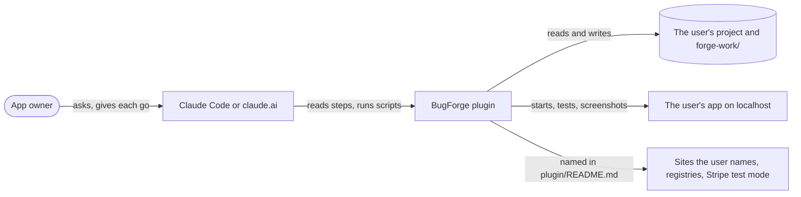
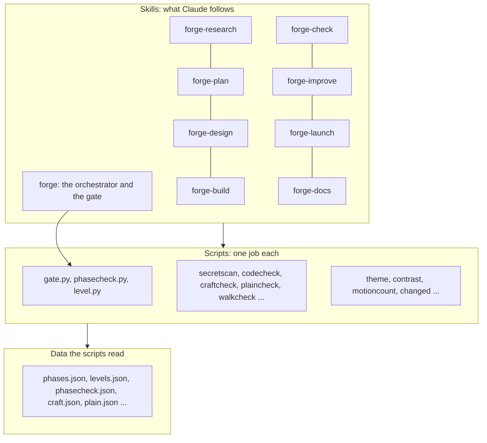
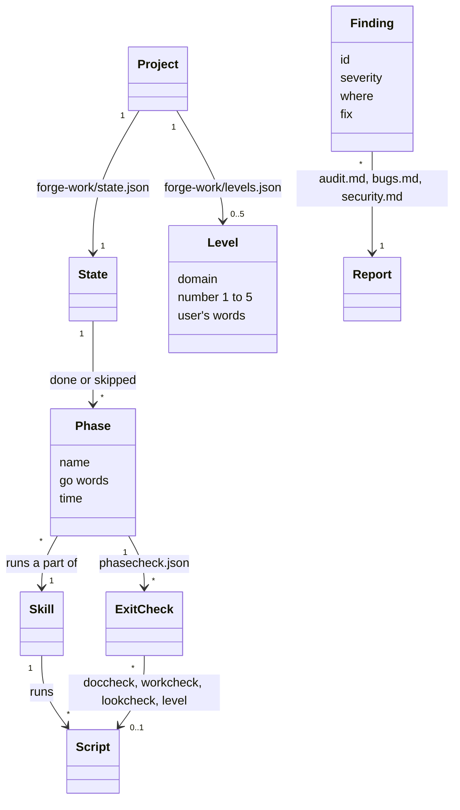
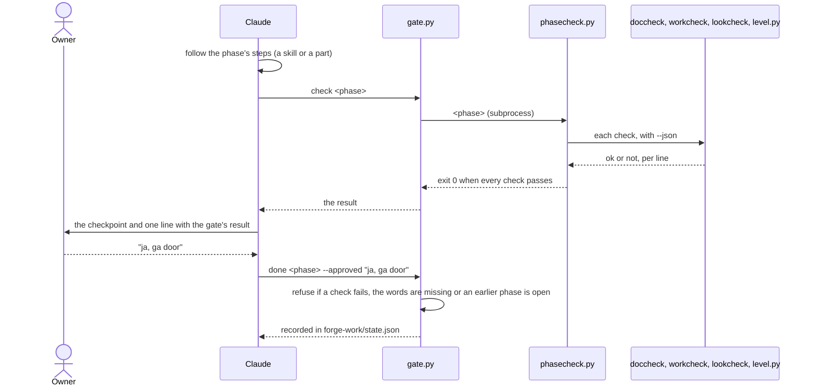
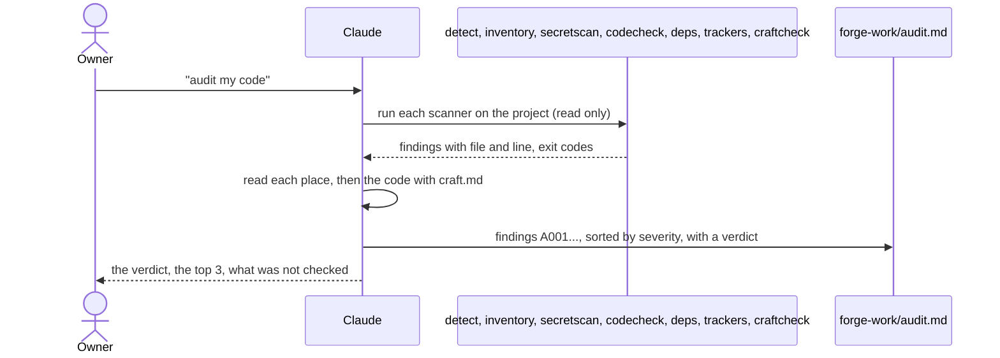
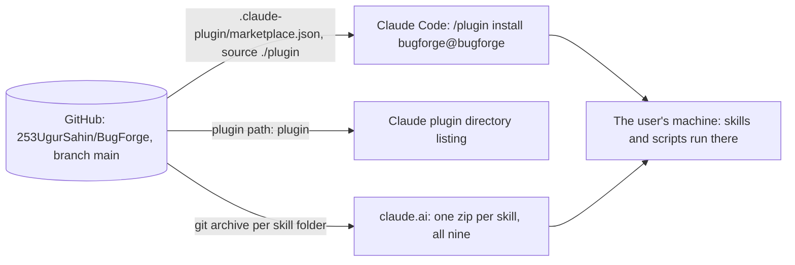

# Architecture

How this was made: from the code at commit 9479de5 on `main`'s line (2026-11-24), by `/forge-docs`.
Read: every skill's `SKILL.md`, `plugin/forge/gate.py`, `phasecheck.py`, `level.py`, `phases.json`,
`levels.json`, the marketplace and plugin manifests and `tests/_load.py`. Run: `detect.py`,
`inventory.py`, `craftcheck.py` and the test suite.

## Context

BugForge is a Claude plugin: nine skills that Claude follows to research, plan, design, build, check,
improve, launch and document a web app on the user's own machine. The user talks to Claude; Claude
reads a skill's steps and runs its scripts in the user's project. Nothing runs on a BugForge server:
there is none. The skills reach outside services only where `plugin/README.md` lists them.

## Logical view: layers and parts

Three layers, each calling only downward:

1. **Skills** (`plugin/<skill>/SKILL.md` and `steps/*.md`): what Claude does, in order, with the
   checkpoints where the user decides. Shared rules live in `plugin/forge/rules.md`.
2. **Scripts** (`plugin/<skill>/*.py`): standard-library Python 3.9, one job each, with `--json` and
   exit codes 0, 1 and 2. A script never imports another script; the scripts of one folder share code
   through `_*.py` helpers next to them.
3. **Data** (`*.json` next to the scripts): the rules, limits, words and patterns the scripts read,
   so a rule changes without changing code.

The orchestrator `/forge` runs the other skills as phases. Which phases a mode has is in
`plugin/forge/phases.json`:

| mode | phases, in order |
| --- | --- |
| clone | recon, compare, plan, design, build, dashboard, motion, test, diff, brand, launch, secure, pack |
| idea | compare, plan, design, build, dashboard, motion, test, brand, launch, secure, pack |
| improve | audit, inspect, improve, test, secure |

## Domain model

The concepts the skills and scripts share, in BugForge's own words (see `glossary.md`).

## Data view

BugForge has no database. Its data are files: what ships in the plugin, and what it writes into the
user's project under `forge-work/`, which is never committed (`gate.py init` writes a `.gitignore`
there).

| file | written by | holds |
| --- | --- | --- |
| `forge-work/state.json` | only `gate.py` | the mode, each phase done (with the user's words of go and the time) or skipped (with the reason) |
| `forge-work/levels.json` | only `level.py` | the level per domain (look, header, dashboard, test, secure) with the user's words |
| `forge-work/plan.md`, `recon.md`, `compare.md` | research and plan | what to build and why |
| `forge-work/design/` | forge-design | brief, tokens, concepts, shots, review |
| `forge-work/bugs.md`, `audit.md`, `security.md`, `improve.md` | forge-check and forge-improve | findings with IDs, severity, where and fix |

## Main flows

### A phase of /forge, with the gate

Claude does a phase's steps, the gate runs its exit checks, the user gives the go in their own words,
and only then does the gate record the phase.

### An audit of the user's code

## Deployment view

BugForge is not deployed; it is installed. The repository is a Claude Code marketplace whose one
plugin is the `plugin/` folder; the directory listing reads the same folder.

Every push to `main` is a release (no `version` in `plugin.json`); the release check runs locally
(README, "Tests").

## States

A phase in `forge-work/state.json`: only done and skipped are written; a passing check alone records
nothing, so the gate runs the checks again at `done`.

```mermaid
stateDiagram-v2
  [*] --> Open
  Open --> Done: done --approved with the user's words, when every exit check passes
  Open --> Done: done --auto in auto mode (never secure)
  Open --> Skipped: skip --reason (optional phases only; never secure)
  Done --> [*]
  Skipped --> [*]
```

## Decisions

- [0001. Skills run standard-library Python scripts](decisions/0001-standard-library-scripts.md)
- [0002. The plugin is the plugin/ folder only](decisions/0002-plugin-folder-only.md)
- [0003. No version: every push to main is a release](decisions/0003-no-version.md)
- [0004. Scripts share code through _ helpers](decisions/0004-shared-helpers.md)
- [0005. A gate that records the user's own words](decisions/0005-gate-with-the-users-words.md)
- [0006. The release check runs locally, without GitHub Actions](decisions/0006-local-release-check.md)

## Quality notes

- 1,952 tests in `tests/` cover every script and the repository's conventions (`tests/test_repo.py`).
  Without Node, the scene kit and screenshot tests are skipped.
- `python3 plugin/forge-check/craftcheck.py plugin` finds no duplicated code, swallowed errors or
  commented-out code. It still lists functions with four or more arguments and some long script
  functions; they get smaller as the code is touched.
- Two false positives that this documentation run found in BugForge's own scanners: `detect.py`
  names a "Django test runner" because a test fixture holds that text, and `inventory.py` lists
  itself as generated because its own pattern holds the words it looks for.
