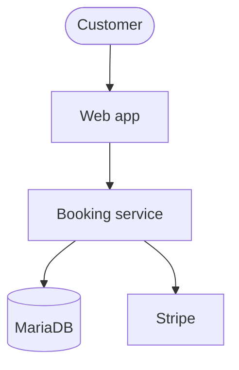
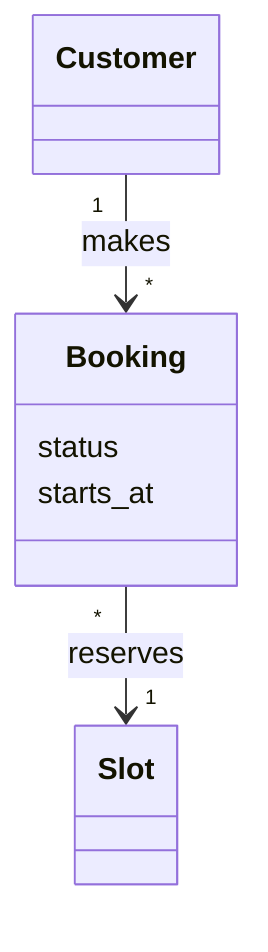
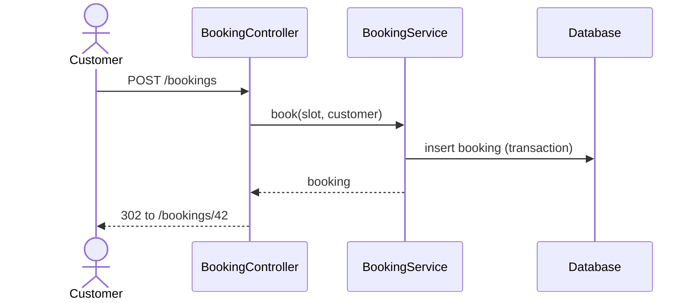

# What goes in each doc

The documentation forge-docs writes, part by part, with a template for each file. The architecture
follows the idea of documenting a system in views, each answering one reader's question, with the
use-case view tying them together (Larman, *Applying UML and Patterns*, ch. 39, after Kruchten's
4+1 views). Diagrams are UML in spirit and Mermaid in syntax, so they render on GitHub and stay text
in git. `docs.json` next to `docslint.py` lists the file and the headings each part must have.

Rules for every part:

- **True to the code.** Every class, table, route, service, folder and command is written under its
  real name and was seen in the code or its output. Unknown: `TO-FILL: <what>`, never a guess.
- **One reader per file.** Write for the person in the table of SKILL.md, in their words.
- **Short.** A diagram has one idea and about 15 boxes at most; a table beats a paragraph; link to the
  code (`app/Models/Booking.php`) instead of pasting it.
- **No secrets, no real people.** Variable names, never values. Example data is made up
  (`alice@example.test`).

## readme: README.md

```markdown
# <App name>

<One sentence: what the app does, for whom.>

## Run it
<the exact commands, from a fresh clone to the app on localhost: compose up, or install + migrate + seed + serve>

## Test it
<the test command(s) and what they need (a test database, Playwright browsers)>

## Configure it
| variable | what it is for | example |
| --- | --- | --- |
<one row per name in .env.example; the example is a fake value or a format>

## How it is built
<stack in one line; a link to docs/architecture.md, docs/api.md, docs/glossary.md, docs/user-guide.md>

## Where things are
| folder | what lives there |
| --- | --- |
```

## architecture: docs/architecture.md

The headings below in this order. Each view is a short paragraph plus its diagram.

```markdown
# Architecture

How this was made: from the code at <commit>, on <date>. <What was run, what was only read.>

## Context
<Who uses the app and which outside systems it talks to (payments, mail, storage, auth).>
<flowchart: people and systems around the app>

## Logical view: layers and parts
<The layers (UI, application, domain, infrastructure) and the main modules or packages in each,
with which may call which. Name any place where a layer is skipped (a view that queries the database).>
<flowchart: layers top to bottom, modules inside them, arrows for "uses">

## Domain model
<The app's main concepts and how they relate, in the business's words (see glossary.md).>
<classDiagram: conceptual classes with their key attributes and associations with multiplicity;
no methods, no framework classes>

## Data view
<The tables, keys and relations as the migrations or the schema define them.>
<erDiagram>

## Main flows
<For each of the 3 to 5 most important tasks (booking, paying, signing in): one paragraph and one
sequence diagram, from the user's click through the route, controller or handler, the services and
the database, to the answer. Name the transaction and where permission is checked.>
<sequenceDiagram per flow>

## Deployment view
<What runs where: the containers or processes, their ports, volumes and what talks to what.>
<flowchart from the compose file or the hosting config>

## States
<Only for things with a lifecycle (an order: draft, paid, shipped, refunded): the states and what
moves between them.>
<stateDiagram-v2>

## Decisions
<A list of links to docs/decisions/, one line each.>

## Quality notes
<What a reviewer should know: where tests are thin, known risks, the craft findings of the last audit
(link forge-work/audit.md only if the user keeps it in the repo).>
```

Diagram kinds and what each shows:

| Mermaid | UML idea | use it for |
| --- | --- | --- |
| `flowchart` | context, package and deployment diagrams | systems, layers, modules, containers |
| `classDiagram` | domain model (conceptual classes) | the business concepts and their associations |
| `erDiagram` | data model | tables, keys and relations |
| `sequenceDiagram` | system sequence and interaction diagrams | one flow across parts, in time order |
| `stateDiagram-v2` | state machine | the lifecycle of one thing |

A small example of each, to copy the syntax from:







## api: docs/api.md

```markdown
# API

Base address, how to authenticate (session cookie, token header), the error format.

| method | path | who may call it | what it does |
| --- | --- | --- | --- |
<one row per route the app's route list shows; group by area>

## <Area>
### POST /bookings
<What it does, the fields it takes with their rules, an example request and answer with made-up data,
the errors it gives and when.>
```

Webhooks the app receives get their own section: the sender, the signature check and what happens.

## glossary: docs/glossary.md

```markdown
# Glossary

| word | meaning | in the code |
| --- | --- | --- |
| Booking | a customer's reservation of one slot | `app/Models/Booking.php`, table `bookings` |
```

One meaning per word. Where the code and the business use different words for one thing, list both
and say which the code uses: that gap is worth knowing (craft.md CR-N4).

## decisions: docs/decisions/NNNN-title.md

One file per decision the code shows was made on purpose: the stack, how auth works, where business
rules live, a pattern used for a reason (a Strategy for prices, an Adapter around the payment
provider). Numbered from 0001, never renumbered.

```markdown
# 0001. <Decision in a few words>

Status: accepted (found in the code, <date>)

## Context
<What problem or constraint led to it.>

## Decision
<What was chosen, with the files that show it.>

## Consequences
<What it makes easy, what it makes hard.>
```

A reason the code does not show: `TO-FILL: why was <x> chosen?`, for the user.

## guide: docs/user-guide.md

For the people who use the app, in plain, professional words (`../forge-design/plain.md`): no technical words, the
app's own button names in bold, one task per section, numbered steps of one action each.

```markdown
# <App name>: how to use it

<Two sentences: what you can do with it.>

## Make a booking
1. Open the app and press **Afspraak maken**.
2. Pick a day. Days you cannot book are grey.
3. ...


## If something goes wrong
<The messages people may see and what to do.>
```

Screenshots go next to the guide, in `docs/user-guide/`, named for the task.

## comments: in the code

Only with the user's go, in a commit of its own, and never a change to what the code does:

- a docstring on each public class and function in the language's own style (PHPDoc, JSDoc,
  Python docstrings, XML doc comments): what it is for, its arguments, what it returns or throws;
- a why-comment next to a rule that surprises (rounding, time zones, money, permissions);
- nothing that repeats the code, no change logs, no commented-out code (craft.md CR-K1 to K4).
